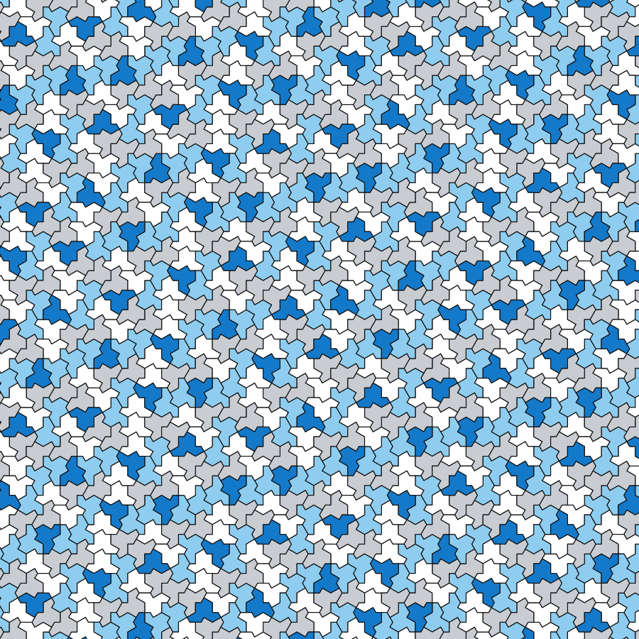
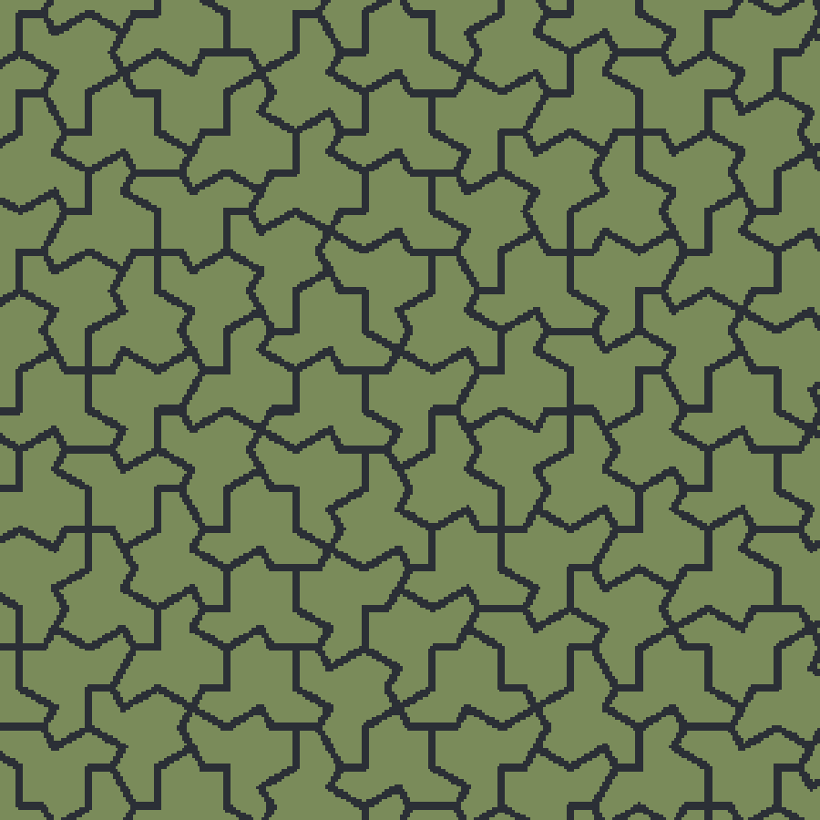

# Hattorio

A Factorio mod. It cuts every planet into cells of the "hat" tiling, the
aperiodic monotile that four mathematicians found in 2023. The cells never
repeat, so your blueprints cannot repeat either.



## Status

Release 1.0.1 is on [the mod portal](https://mods.factorio.com/mod/hattorio)
and on the [GitHub releases page](https://github.com/vetkat/hattorio/releases).
It needs Factorio 2.1. Space Age is optional. The [roadmap](ROADMAP.md) lists
what comes next.

> **Warning:** multiplayer is not verified. The argument that every client
> calculates the same cells is sound, but no test with two clients exists
> yet. Play single player for now.

## What it does to your game

Each cell is a hat. A narrow unbuildable band separates each cell from its
neighbours. You can walk and drive across a band, and underground belts and
pipes go under it. You cannot build anything on a band.

- **Imported blueprints stop fitting.** Each cell has a different shape. At
  the default settings, 1,156 measured cells have 885 different buildable
  tile shapes. No single shape covers more than 0.5% of the map, so a layout
  that fills one cell does not fit the next.
- **Small blueprints still fit everywhere.** At the default settings,
  anything up to 17×17 fits in every cell. An assembler cluster fits. A
  30×30 mall does not.
- **Each connection between cells is a puzzle.** Belts cross a band with an
  underground pair, and the cell edge is never parallel to an axis.



## Settings

You set these per planet when you create the world.

| Setting | Default | Choices |
| --- | --- | --- |
| Cell size (centre to vertex, tiles) | **41** (normal) | 15, 26, 41, 52 |
| Band width (tiles) | **3** (wide) | 1, 2, 3, 4 |
| Band appearance | Dark liquid | liquid, void |
| Band colour | Deep violet | violet, cold, oily, ember, void black |

The cell size sets how much room you get, and the largest blueprint that
fits in every cell. At the default band width of 3:

| size | difficulty | cell area | reusable blueprint | preview |
| --- | --- | --- | --- | --- |
| 15 | very hard | 63 t | 5×5 | [look](docs/preview/bands-15-2.png) |
| 26 | hard | 294 t | 10×10 | [look](docs/preview/bands-26-2.png) |
| **41** | **normal** | **858 t** | **17×17** | [look](docs/preview/bands-41-3.png) |
| 52 | easy | 1,473 t | 22×22 | [look](docs/preview/bands-52-2.png) |

A later change to a setting applies only to new surfaces. An existing
surface keeps the geometry that its terrain has, so no seam appears.

## How it works

The square grid is part of the engine. Tiles, collision, belt lanes, pipes
and the pathfinder are C++ code, and they all expect 1×1 tiles on the axes.
A mod cannot give the unit of construction a hat shape. It can decide where
you may build, and Hattorio does only that.

The tiling is aperiodic, so it has no lattice to snap to and no period to
use. To find the hats that overlap a chunk, the mod goes down a substitution
tree and uses bounding circles to skip branches. This takes about 0.7 ms per
chunk.

The [wiki](../../wiki) has the details. It shows how the limiting metatiles
came out as exact algebraic numbers, and why plain doubles beat exact integer
arithmetic by nine orders of magnitude.

## For developers

```text
hat/         the tiling core, with no Factorio dependencies; runs under plain Lua
tools/       offline pipeline (Python) that derives and verifies the rule data
data/        generated Lua data; never edit by hand
spec/        busted tests
tests/       in-game tests, which run in the Factorio headless server
docs/design/ the design spec, including everything that turned out wrong
```

You need Lua 5.2 (the version that Factorio embeds), busted, luacheck,
Node.js and lychee:

```bash
sudo pacman -S --needed lua52 lua52-busted luacheck nodejs npm lychee   # Arch
make setup          # once: npm tools and the git hook
make fast           # the quick checks; the git hook runs them
make check          # everything, including the in-game tests
make data           # regenerate data/ and test fixtures
lua5.2 tools/render.lua 5 12 340 out.svg              # draw the tiling
lua5.2 tools/render_bands.lua 26 2 260 bands.svg      # preview in-game look
```

The first `make check` downloads the Factorio headless server, about 60 MB.
[toolchain-decisions.md](docs/design/toolchain-decisions.md) describes the
checks, CI and the release workflow.

A golden fixture from the Python pipeline validates the Lua core. The pipeline
checks the fixture itself: it has no overlaps or gaps, the density of
reflected hats is correct, and the hat counts match F(2n+3)².

## Credits

David Smith, Joseph Samuel Myers, Craig S. Kaplan and Chaim Goodman-Strauss
discovered the hat monotile in 2023. The substitution structure in this mod
comes from Kaplan's [hatviz](https://github.com/isohedral/hatviz)
(BSD-3-Clause). See [THIRD_PARTY.md](THIRD_PARTY.md).

[Hextorio](https://github.com/sOvr9000/hextorio) solved several of the same
problems for hexagons first. Hattorio uses its method to store geometry per
surface.

MIT licensed.
