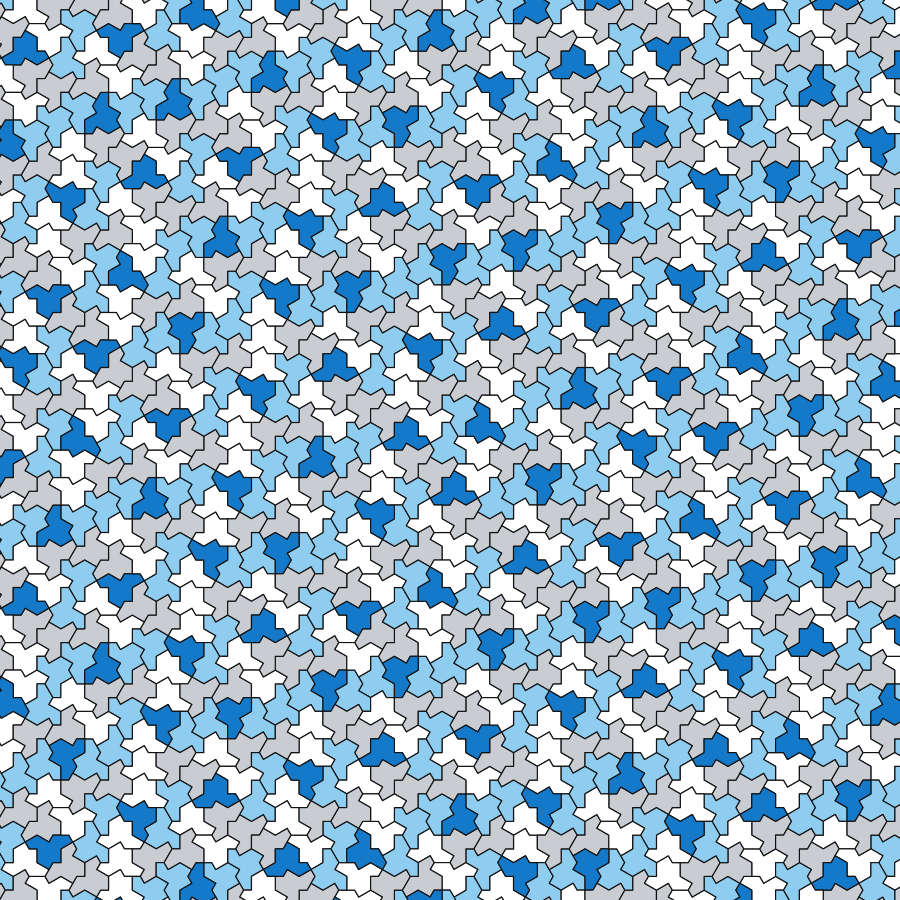
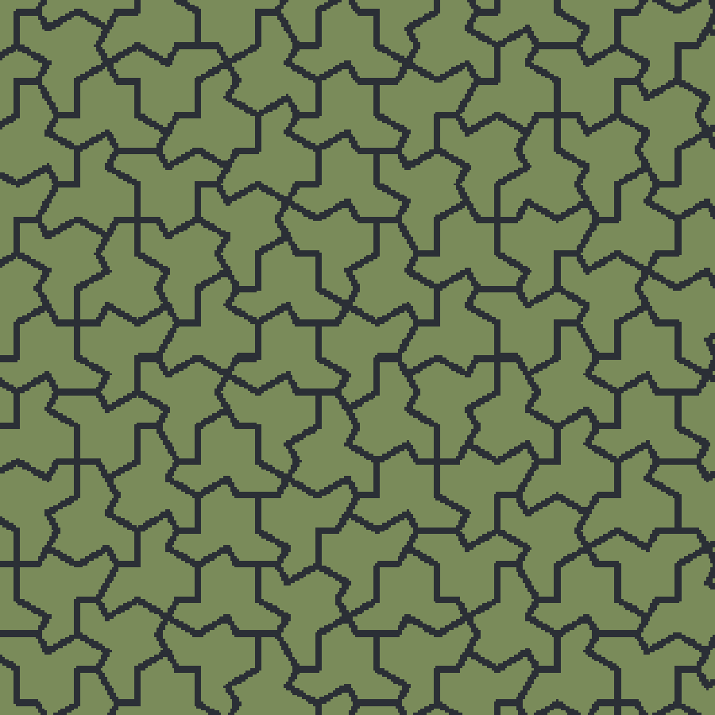

# Hattorio

**The mod divides every planet into cells of the aperiodic "hat" monotile
tiling. No two cells have the same shape. Your blueprint library stops
working.**

In 2023 four mathematicians found the first shape that tiles the plane and
*never repeats*. They called it the hat. Hattorio builds your factory on it.

Each hat is a buildable **cell**. A narrow **band** runs between the cells,
and you cannot build on it. You can walk and drive across a band freely.
Underground belts and pipes pass under it, rails cross it, and power and bots
ignore it. You cannot build anything on the band itself.

That one rule is the whole mod.

## Why your blueprints stop fitting

Rotation is not the cause. **Every cell has a different shape.**

The hat cells sit at irrational offsets from Factorio's square tile grid, so
each cell rounds onto the squares in a different way. We measured 1,156 cells
at the default settings and found **885 different buildable shapes**. No
single shape covers more than **0.5%** of the map.

A layout that fills one cell will not fit the next one. Copy and paste will
not get you out of this.

**Small blueprints still work everywhere.** At the default settings, anything
up to 17×17 fits in every cell. So an assembler cluster or a bank of splitters
is fine. A blueprint that tries to *use* a cell efficiently fails. If you fill
the space, you fit the layout to that cell and to no other.

You must build the factory for the ground it stands on.

## What you do differently

- **Think in cells, not in a bus.** A main bus needs parallel lines that run
  as far as you want. Here they cannot. Each cell becomes a small factory with
  one job.
- **Every crossing is a decision.** Belts leave a cell with an underground
  pair, and the cell edge is never parallel to an axis.
- **Trains matter more.** Rails cross bands freely, so over long distances
  they are much easier than belts.
- **Bots make everything easier.** They fly over the whole problem, and they
  arrive with normal progression. This is intended.

## Settings

You set the cell size and the band width **per planet** when you create the
world.

| Cell size | Cell area | Largest blueprint that fits every cell |
| --- | --- | --- |
| 15: very hard | 63 tiles | 5×5 |
| 26: hard | 294 tiles | 10×10 |
| **41: normal (default)** | **858 tiles** | **17×17** |
| 52: easy | 1,473 tiles | 22×22 |

For scale, a smelter block is about 20×20 and a mall is about 30×30. So
**every option breaks real imported blueprints**. The size only sets how much
room you get to improvise.

The band width is 1 to 4 tiles. Underground belts can cross every width, so
no cell is ever isolated.

By default the bands are an animated dark liquid. You can choose one of five
colours, or a flat void if you prefer something still. About one cell in
eight is a mirror image. This is mathematically necessary in this tiling. The
mod tints these cells so that you can find them.

Bands put some ore out of the reach of a 3×3 mining drill. The mod
compensates for this automatically and scales the compensation to your
settings. `/hattorio-info` shows the geometry and the richness that your
surface uses.

## Before you start

- **Start a new world.** The mod paints the bands when chunks generate. In an
  existing save, the areas that you already explored keep vanilla ground, and
  a permanent boundary remains. The mod warns you if you add it to a world in
  progress.
- **Single player for now.** The argument for multiplayer determinism is
  sound: the tiling uses only correctly rounded IEEE arithmetic and no
  trigonometry. But no test with two clients exists yet. Please do not rely
  on it in multiplayer yet.
- You need Factorio 2.1 or later. The mod supports Space Age, but it does not
  need it.

## Credits

David Smith, Joseph Samuel Myers, Craig S. Kaplan and Chaim Goodman-Strauss
discovered the hat monotile in 2023. The substitution structure in this mod
comes from Kaplan's [hatviz](https://github.com/isohedral/hatviz).

[Hextorio](https://mods.factorio.com/mod/hextorio) did this for hexagons
first and solved several of the same problems.

MIT licensed. The source code and a description of how the mod generates the
tiling are at
[github.com/vetkat/hattorio](https://github.com/vetkat/hattorio).
