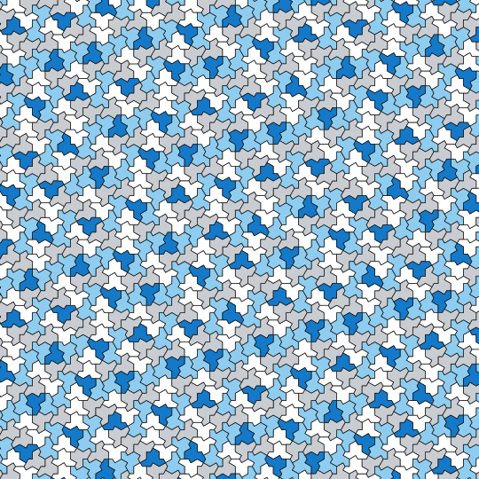
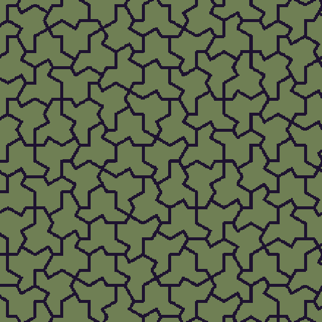

# Hattorio

A Factorio mod. It cuts every planet into cells of the hat tiling, the
aperiodic monotile found in 2023. The tiling never repeats, so no two cells
have the same shape, and your blueprint library stops fitting.

## Why this mod exists

Most experienced players build a green circuit block the same way. Three
assemblers make copper wire and feed two that make circuits. An iron plate
belt runs down the side. The power poles sit so that the block tiles cleanly
and repeats in one direction for ever.

Players found the ratios early, or looked them up, and then stamped the
result down in every game after that. The block is correct. A solved
problem stays solved, and each new game reaches the same rectangles a little
faster.

In 2023 four mathematicians answered a question that was fifty years old: can
one shape tile the plane and never repeat? It can, and they called it the hat.
A tileable blueprint cannot work on a floor plan that never repeats. Hattorio
puts that floor plan on the map.

## What the mod does

Each hat is a buildable cell. A narrow band runs between the cells, and you
cannot build on it. You can walk and drive across a band. Underground belts
and pipes go under it, rails cross it, and power and bots ignore it.

A band also runs under water. You cannot fill it with landfill, foundation
or ice platform. On Aquilo and Fulgora it shows as a dark line over the
ocean. On the other planets it looks the same as the water.

The mod adds no items, recipes or technologies, so your ratios do not
change. It only limits where you can build.

## Why your blueprints stop fitting

Rotation costs one keypress. Hats occur in twelve orientation classes.
Factorio rotates in 90° steps and 2.0 can flip, so the twelve classes come
down to about three, and `r` cycles between them.

Position is the real cause. The hats sit at irrational multiples of the tile
pitch. So each cell meets the square grid at a different sub-tile offset,
and it rasterises into a different set of squares. At the default settings, 1,156
measured cells have 885 different buildable shapes. The most common shape
covers 0.5% of the map. A layout that fills one cell fits that cell and no
other.

Small blueprints still work. At the default settings, anything up to 17×17
fits every cell on the map. You keep your knowledge of the game. You lose
the habit of stamping a block that fills a space well, because no two spaces
are the same.

## What changes in play

**Look before you build.** Cells meet their neighbours in different ways.
Some share a long edge, and some touch at a point. A group of cells that
fits well together is worth the walk, and the map shows you where it is.

**Cells replace the bus.** A bus needs parallel lines that run as far as you
want, and nothing here runs that far. Each cell becomes a small factory with
one job, and the decisions move to the connections between cells.

**Each crossing needs a plan.** Belts leave a cell with an underground pair,
and the cell edge is never parallel to an axis. Power poles ignore the
ground, so power is never the problem. You build and rebuild belts the most.

**Trains come earlier.** Rails cross bands freely, so over any distance they
cost much less than belts.

**Bots remove the constraint.** They fly over the bands, and they arrive with
normal progression. This is intended. The constraint is strongest in the
belt era and gets weaker as you research.

## Settings

You set the cell size and the band width per planet when you create the
world. In Space Age, each planet has its own pair, so Nauvis can be easy
while Vulcanus is not.

| Cell size | Cell area | Largest blueprint that fits every cell |
| --- | --- | --- |
| 15: very hard | 63 tiles | 5×5 |
| 26: hard | 294 tiles | 10×10 |
| _41: normal (default)_ | _858 tiles_ | _17×17_ |
| 52: easy | 1,473 tiles | 22×22 |

A smelter block is about 20×20 and a mall is about 30×30. Every size breaks
an imported blueprint, "easy" included. The size sets how much room you get
to improvise.

The band width is 1 to 4 tiles. An underground belt crosses every width, so
no cell is cut off from its neighbours.

**Ore.** Bands put some ore out of reach of a 3×3 drill. In new chunks the
mod raises the richness to compensate, and it scales the increase to your
cell size and band width. A manual multiplier replaces the calculated value
if you want to set it yourself. `/hattorio-info` shows the geometry and the
richness of the surface under you.

**Appearance.** The bands are an animated dark liquid by default, or a flat
void if you want them still. Both come in five near-black colours. The
highlight at the edges makes the bands visible. About one cell in eight is
reflected, and the mod gives these cells a stronger tint so that you can find
them. A per-player option draws a line down the centre of each band.

## Before you start

**Start a new world.** The mod paints the bands when a chunk generates. If
you add Hattorio to a save in progress, the explored area keeps vanilla
ground, with a permanent seam at its edge. The mod tells you when this
happens, but it cannot undo it.

**Each surface keeps its settings.** The terrain records the cell size and
the band width when it generates. A later change applies only to new
surfaces, so no seam appears in the middle of the map.

**Single player for now.** The tiling uses only correctly rounded IEEE
arithmetic and no trigonometry, so every client calculates the same cells.
No test with two connected clients exists yet. If you play it in
multiplayer and have problems, report them in the comments below or in an
[issue on GitHub](https://github.com/vetkat/hattorio/issues).

**Factorio 2.1 or later.** The mod works with and without Space Age.

**Other mods can use the cells.** A mod that gives each team its own copy
of a planet can tell Hattorio which planet a surface copies. All teams then
build on the same cells. The remote interface `hattorio` does this, and
[the design document](https://github.com/vetkat/hattorio/blob/main/docs/design/hattorio-design.md#8-terrain-generation)
describes it.

## Credits

David Smith, Joseph Samuel Myers, Craig S. Kaplan and Chaim Goodman-Strauss
found the hat in 2023. Smith found the shape, and the other three proved
that it tiles the plane without repeating.

Hattorio generates the tiling with a substitution structure from Kaplan's
[hatviz](https://github.com/isohedral/hatviz) (BSD-3-Clause). See
[THIRD_PARTY.md](https://github.com/vetkat/hattorio/blob/main/THIRD_PARTY.md).

[Hextorio](https://mods.factorio.com/mod/hextorio) did this for hexagons
first and solved several of the same problems. Hattorio uses its method to
store the geometry per surface.

Hattorio is MIT licensed. The source code and a description of how the mod
generates the tiling are at
[github.com/vetkat/hattorio](https://github.com/vetkat/hattorio). The
[wiki](https://github.com/vetkat/hattorio/wiki) covers the maths. It shows
how the limiting metatiles came out as exact algebraic numbers. It also shows
why plain doubles beat exact integer arithmetic by nine orders of magnitude
in Lua 5.2.

## Use of generative AI

A large language model wrote most of the code. The author set the direction,
made the design decisions, reviewed the results and decided what shipped.

Generated code can make claims that nobody checked. So the mod
does not ask you to trust it:

- A golden fixture from a separate Python pipeline validates the Lua core
  that produces the tiling.
- The pipeline checks the fixture for overlaps and gaps, for the density of
  reflected hats, and for hat counts that match F(2n+3)².
- Every figure on this page is a measurement. If the documentation and the
  code disagree about a figure, a test fails the build.
- The code, the tests and a design document that records what turned out to
  be wrong are on GitHub, under the MIT licence.

None of this makes the mod correct, but you can check it. Multiplayer is the
one part without a check yet. If you try it, report what happens.
