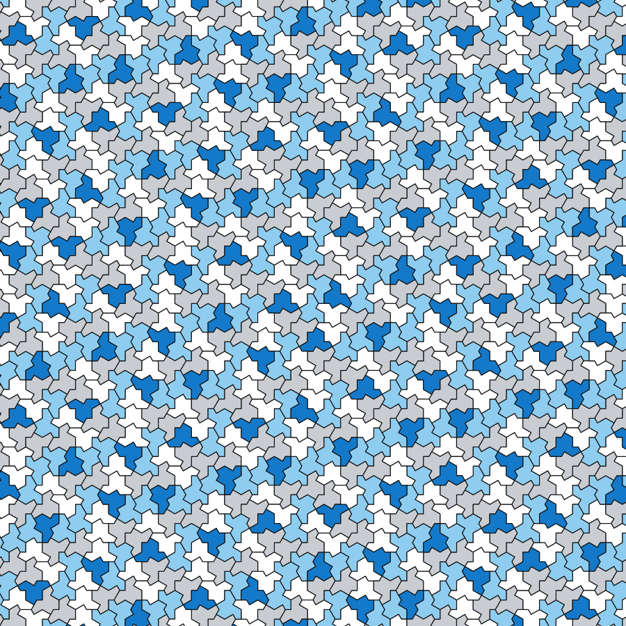
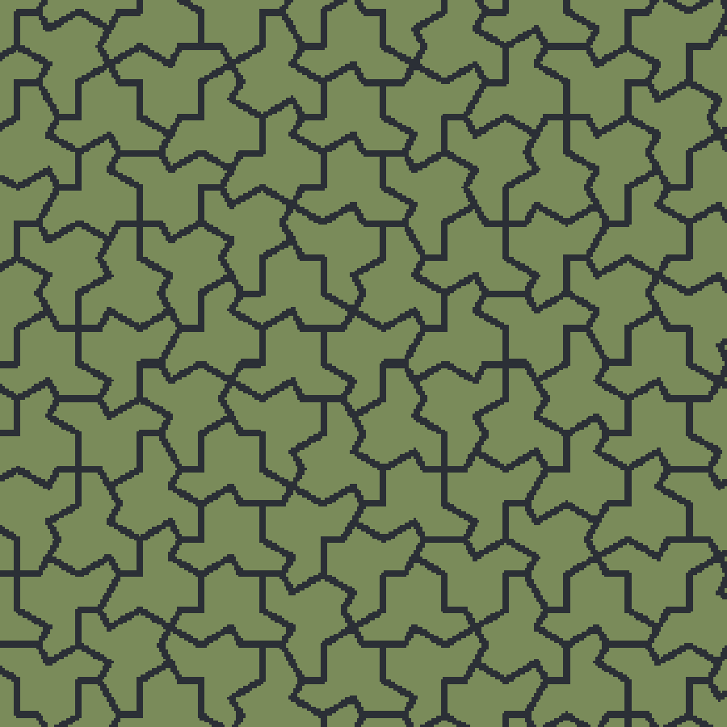

# Hattorio

**Every planet is cut into cells of the hat tiling. The hat is the aperiodic
monotile that was found in 2023. The tiling never repeats, so no two cells
have the same shape, and your blueprint library stops fitting.**

## Why does this mod exist?

Ask any experienced Factorio player to sketch a green circuit build. I bet
I'd get roughly the same thing back every time. Three assemblers make copper
wire and feed two that make circuits. An iron plate belt runs down the side.
The power poles are placed so that the whole block tiles cleanly and marches
off in one of the cardinal directions for ever.

We did not each arrive there on our own. At some point early on, we worked
out the ratios or looked them up. Then we stamped the result down and never
had a reason to think about it again.

That block isn't bad. It's correct, and that is the problem. A solved problem
stays solved. Every playthrough after the first one arrives at the same
rectangles a little faster than the last.

In 2023 four mathematicians answered a question that had been open for fifty
years: can one shape tile the plane and never repeat? It can, and they called
it the hat.

A tileable blueprint cannot survive a floor plan that never repeats. So I put
that floor plan on the map and built the factory on it.

## What this mod does

Each hat is a buildable cell. A narrow band runs between the cells, and you
cannot build on it. You can walk and drive across a band, but underground
belts and pipes must go under it. Rails do cross it, and power and bots ignore
it.

That is the whole mod. It adds no items, recipes or technologies, so the
ratios you already know are still the ratios. The only restriction is where
you can put things.

## Why your blueprints stop fitting

If this were only about orientation, it would cost you one keypress. Hats
occur in twelve orientation classes. Factorio rotates in 90° steps and 2.0
can flip, so those twelve classes collapse to about three, and `r` cycles
between them for free.

The real cause is that hats sit at irrational multiples of the tile pitch.
Every cell meets the square grid at a different sub-tile offset, so every cell
rasterises into a different set of squares. I measured 1,156 cells at the
default settings and found 885 different buildable shapes. The most common
shape covers 0.5% of the map.

So a layout that fills one cell fits that cell and no other.

### Blueprints up to a certain size still work

At the default settings, anything up to 17×17 fits every cell on the map.
That is the real limit of the mechanism, and it is deliberate. The mod does
not take away your knowledge. It takes away the habit of stamping a block
that uses a space well, because no two spaces are the same.

## What changes in play

**Think ahead.** Cells are all different, and they meet each other in
different ways. Some neighbours share a long edge, and some touch at a point.
A group of cells that fits well together is worth the walk, and you can only
see it on the map.

**Cells replace the bus.** A bus needs parallel lines that run as far as you
want. Nothing here runs that far. Each cell becomes a small factory with one
job, and the interesting decisions move to the connections between cells.

**Every crossing needs a plan.** Belts leave a cell with an underground pair,
and the cell edge is never parallel to an axis. Power poles ignore the ground,
so power is never the problem. Belts are the problem, and you will build and
rebuild them the most.

**Trains get better.** Rails are exempt and cross bands freely, so at any
distance they hurt much less than belts. Expect to build rail earlier than
usual.

**Bots will lift the constraint.** They fly over the whole problem, and they
arrive with normal progression. That is intended. The constraint should hurt
most in the belt era and ease as you research more. It should not follow you
to the end of the run.

## Settings

You set the cell size and the band width per planet when you create the
world. In Space Age each planet gets its own pair, so Nauvis can be
comfortable while Vulcanus is not.

The cell size controls how much pain you are about to receive:

| Cell size | Cell area | Largest blueprint that fits every cell |
| --- | --- | --- |
| 15: very hard | 63 tiles | 5×5 |
| 26: hard | 294 tiles | 10×10 |
| _41: normal (default)_ | _858 tiles_ | _17×17_ |
| 52: easy | 1,473 tiles | 22×22 |

A smelter block is about 20×20 and a mall is about 30×30. So every option,
"easy" included, breaks an imported blueprint. The size only sets how much
room you get to improvise.

The band width is 1 to 4 tiles. An underground belt can cross every width, so
no cell is ever cut off from its neighbours.

**Ore.** Bands put some ore out of the reach of a 3×3 drill. In new chunks
the mod raises the richness automatically to compensate, and it scales the
increase to your cell size and band width. If you prefer to set it yourself,
there is a manual multiplier. `/hattorio-info` shows the geometry and the
richness that the surface under you actually uses.

### Appearance

By default the bands are an animated dark liquid. You can also choose a flat
void if you prefer something still. Both come in five near-black colours. The
highlight at the edges of the surface is what makes the bands visible. About
one cell in eight is reflected, and the mod gives these cells a stronger tint
so you can spot them. A per-player option draws a line down the centre of
each band if you want clear boundaries.

## Before you start

### Start a new world

The mod paints the bands when chunks generate. If you add Hattorio to a save
in progress, everything you already explored keeps vanilla ground, with a
permanent seam at its edge. The mod tells you when this happens, but it cannot
undo it.

### Your settings are fixed per surface

The terrain records the cell size and band width when it generates. If you
change them later, the change applies only to new surfaces. A world in
progress keeps the geometry it was built with, so no seam appears in the
middle of the map.

### Single player, for now

The tiling uses only correctly rounded IEEE arithmetic and no trigonometry,
so every client calculates the same cells. But nobody has tested it with two
connected clients yet. If you try it in multiplayer and have problems, let me
know in the comments below or open an
[issue on my GitHub repo](https://github.com/vetkat/hattorio/issues).

### Factorio 2.1 or later

Space Age is supported but not required.

## Credits and inspiration

David Smith, Joseph Samuel Myers, Craig S. Kaplan and Chaim Goodman-Strauss
found the hat in 2023. Smith found the shape. The other three proved that it
does what it appears to do.

Hattorio generates the tiling with a substitution structure that comes from
Kaplan's [hatviz](https://github.com/isohedral/hatviz) (BSD-3-Clause). See
[THIRD_PARTY.md](https://github.com/vetkat/hattorio/blob/main/THIRD_PARTY.md).

[Hextorio](https://mods.factorio.com/mod/hextorio) did this for hexagons
first and had already solved several of the same problems. Hattorio uses its
method to store geometry per surface.

Hattorio is MIT licensed. The source code and a description of how the mod
generates the tiling are at
[github.com/vetkat/hattorio](https://github.com/vetkat/hattorio). The
[wiki](https://github.com/vetkat/hattorio/wiki) covers the maths. It shows how
I recovered the limiting metatiles as exact algebraic numbers. It also shows
why plain doubles beat exact integer arithmetic by nine orders of
magnitude (in Lua 5.2 at least).

## Use of GenAI and LLMs

A large language model wrote most of the code in this mod. I set the
direction, made the design decisions, reviewed what came back and decided
what shipped. But I'm not going to claim I typed it.

I'm saying so because you have a right to know. The obvious worry is also a
fair one: generated code is confident about things it has not checked. So I
built the mod so that you do not have to rely on that confidence.

A Lua core produces the tiling. A golden fixture from a separate Python
pipeline validates that core. The pipeline checks the fixture itself for
overlaps, for gaps, for the correct density of reflected hats and for hat
counts that match F(2n+3)². Every figure in this description is a
measurement. If the documentation and the code stop agreeing about these
figures, a test fails the build. All of it is MIT licensed and on GitHub. That
includes a design document that records what turned out to be wrong.

None of that makes the mod correct. It makes the mod checkable, and that is
the most I can honestly offer. The one thing I haven't been able to check is
multiplayer. So if you feel like it, please try it, and if you have problems,
let me know.
