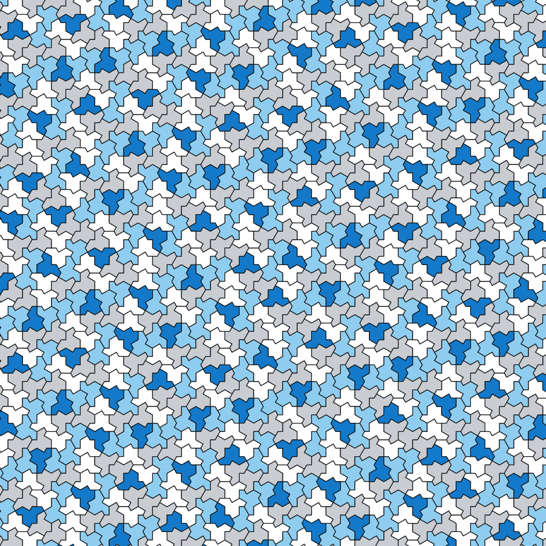
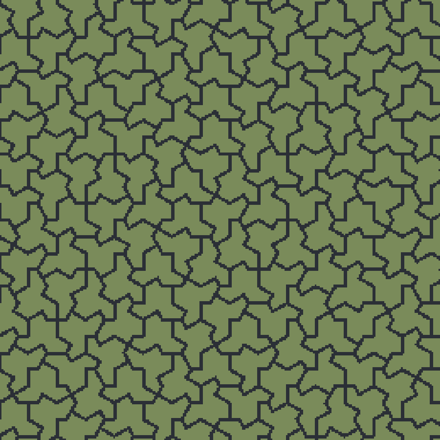

# Hattorio

**Factorio, but the ground is an aperiodic tiling.**

You build your factory on the "hat" monotile. Four mathematicians found this
shape in 2023. It tiles the plane and the pattern never repeats. Every cell
is a hat, and no two cells are quite the same. Your blueprints will not save you.

> **Released as 1.0.0**, on
> [the mod portal](https://mods.factorio.com/mod/hattorio). Nobody has
> verified multiplayer yet, so play single player for now.

## How it plays

Each hat is a buildable **cell**. A narrow **band** runs between the cells,
and you cannot build on it. You can walk and drive across a band freely, and
underground belts and pipes can pass under it. You cannot build anything on
the band itself.

That one rule is the whole mod, and it changes everything that follows.

### Your blueprint library stops working

Rotation is not the cause. **Every cell has a different shape.**

The hat cells sit at irrational offsets from Factorio's tile grid, so each cell
rounds onto the squares in a different way. We measured 1,156 cells at the
default settings and found **885 different buildable shapes**. No single shape
covers more than 0.5% of the map.

A layout that fills one cell will not fit the next one.

### Small blueprints still work everywhere

This mod does not delete blueprints. At the default size, anything that fits
in a 17×17 square works in every cell. Examples are an assembler and its
inserters, a bank of splitters or a small power block.

A blueprint that tries to *use* a cell efficiently fails. If you fill the
space, you fit the layout to that cell and to no other.

### The interesting part is to move between cells

Belts cross a band with an underground pair. Bands are never parallel to an
axis, so a crossing is never tidy. Rails are exempt and cross freely, so
trains still work. Power poles and bots ignore the ground.

The factories that you build here are not ugly by accident. They fit their
ground.

## Where to go next

- **[Settings](Settings):** hat size is the most important setting. Start
  here.
- **[Building in hats](Building-in-hats):** practical advice for your first
  base.
- **[The mathematics](The-mathematics):** how the mod generates the tiling.
  You do not need this to play.

## Credits

David Smith, Joseph Samuel Myers, Craig S. Kaplan and Chaim Goodman-Strauss
discovered the hat monotile in 2023. The substitution structure comes from
Kaplan's [hatviz](https://github.com/isohedral/hatviz).
[Hextorio](https://github.com/sOvr9000/hextorio) did this for hexagons first
and solved several of the same problems.
