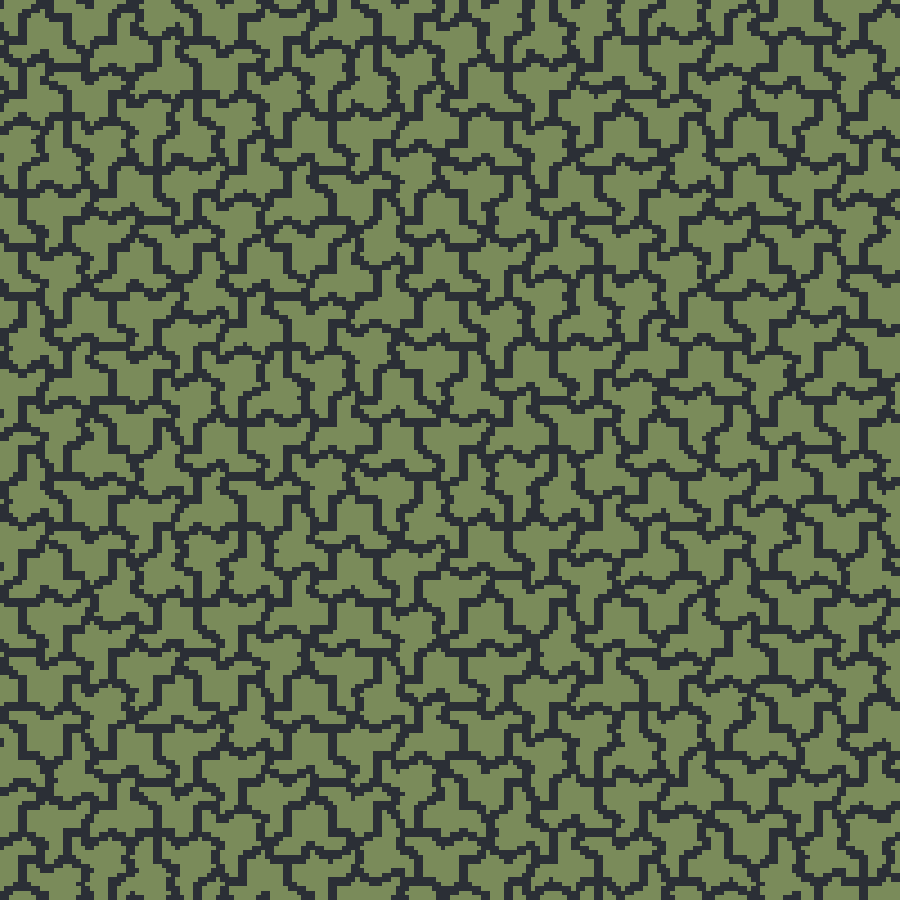
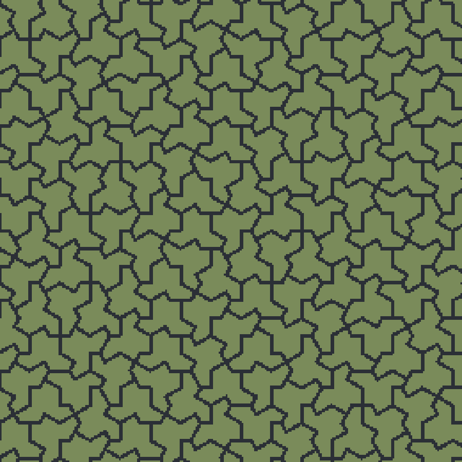
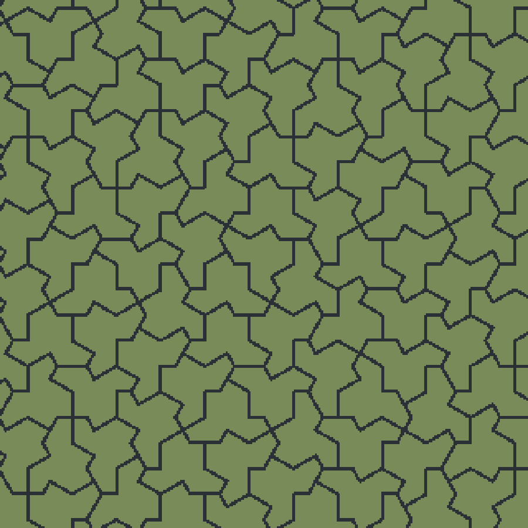
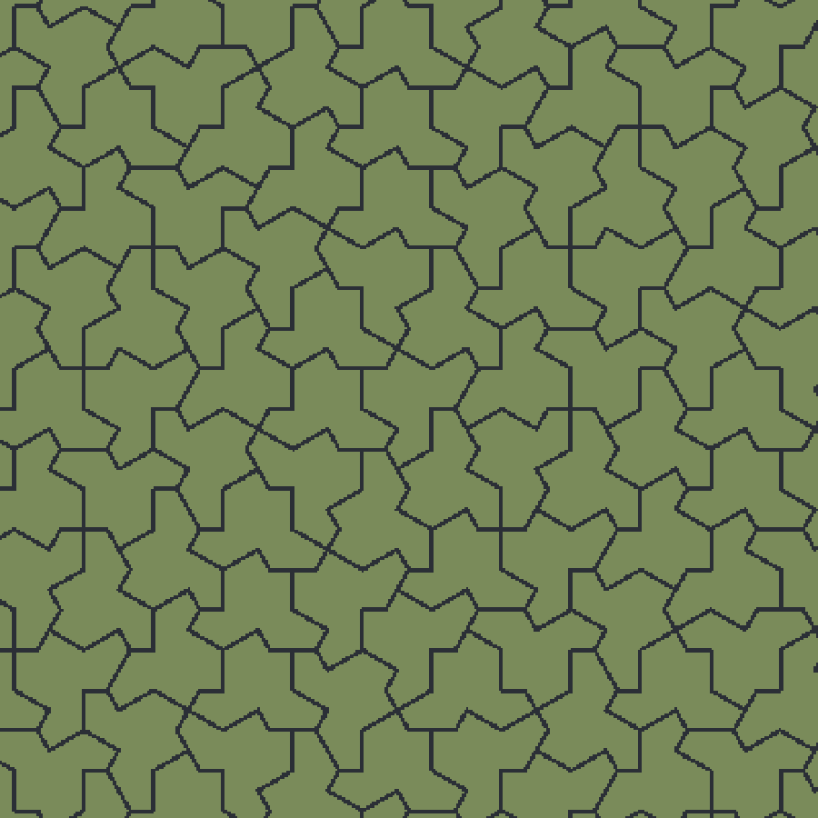

# Settings

Each planet has its own settings. You set them when you create the world, and
they stay fixed after that.

| Setting | Default | Choices |
| --- | --- | --- |
| Cell size (centre to vertex, in tiles) | **41** (normal) | 15, 26, 41, 52 |
| Band width (tiles) | **3** (wide) | 1, 2, 3, 4 |
| Band appearance | Dark liquid | liquid, void |
| Band colour | Deep violet | violet, cold, oily, ember, void black |

Cell size and band width are dropdowns. Each choice has a label that tells you
how hard it makes the game. You set them per planet.

## Hat size is the most important setting

Hat size sets how much room a cell gives you. More importantly, it sets the
largest blueprint that you can reuse everywhere.

At the default band width of 3:

| Size | Difficulty | Cell area | Largest blueprint that fits every cell |
| --- | --- | --- | --- |
| 15 | very hard | 63 tiles | 5×5 |
| 26 | hard | 294 tiles | 10×10 |
| **41** (default) | **normal** | **858 tiles** | **17×17** |
| 52 | easy | 1,473 tiles | 22×22 |

A wider band makes the cell smaller, and a narrower band makes it larger. At
band 1, a size-41 cell holds 1,012 tiles and takes a 19×19 blueprint.

For scale, a smelter block is about 20×20 and a mall is about 30×30. **Every
size in this table breaks those blueprints.** So the choice is how much room
you get to improvise.

- **15** is brutal. A cell holds one machine and some belt. It is new, and
  probably exhausting.
- **26** is hard. 10×10 is about one assembler cluster. That is enough to
  build without a fight, but you must fit everything larger by hand.
- **41** is the default. Each cell holds real sub-builds, the spaghetti goes
  mostly between cells, and every imported blueprint still breaks.
- **52** has the same area as Hextorio's hexagons, if you want that feel.

## Band appearance

Two settings control the look of the bands: the material and the colour. They
are independent, and every combination works.

**Style** sets the surface. *Dark liquid* is the default, and it moves and
oozes. *Void* is flat and still. It looks like a hole, not a
liquid.

**Colour** sets the tint. Every option is nearly black on purpose, so the bands
look like depth and not like paint. The highlight at the edges of the surface
is what makes the bands visible. *Deep violet* is the default and looks the
most deliberate. *Near-black cold*, *oily green-black* and *ember black* are
quieter. *Pure void black* is a flat hole with no sheen.

About one cell in eight is a mirror image. The tiling needs these reflected
cells, as a proof shows. The mod gives them a stronger tint so that you can
find them.

## Band width

This is the width of the unbuildable strip. Keep it smaller than the reach of
your underground belts, or the cells become fully isolated. The default width
is 3. You can see it clearly, and every tier of underground belt can cross
it.

Wider bands use more of the map. The unbuildable fraction grows about
linearly with the band width.

## Why you cannot change these during a game

The geometry controls the terrain. Suppose you change it in an existing save.
Every chunk that already exists keeps the old geometry, every new chunk gets
the new one, and the seam between them stays for ever.

If you change a setting later, the change applies **only to new surfaces**.
Existing surfaces keep the geometry that their terrain was built with, so no
seams appear.

## Ore

Bands cut through ore patches, and a mining drill needs a clear 3×3 area. So
you cannot reach some of the ore. The mod raises the richness to compensate.
It uses measured values, not a guess. The reachable fraction is 80% at the
largest cells and falls to 5% at the smallest cells with the widest band.

`/hattorio-info` shows the cell size, the band width and the richness
multiplier that your surface actually uses. It also tells you if the mod
calculated the multiplier or took it from the override setting.

## Combinations to avoid

Cell size and band width are independent dropdowns. So you can pick a few
combinations that do not make sense:

| | cell | largest blueprint | reachable ore | |
| --- | --- | --- | --- | --- |
| 15 / 3 | 63 tiles | 5×5 | 11% | ore very scarce |
| 15 / 4 | 46 tiles | 4×4 | 5% | close to unplayable |

A mining drill and an assembling machine are both 3×3. In a cell where the
largest square is 4×4, nothing is left to connect them. The mod warns you when
the game loads if you choose one of these combinations.
